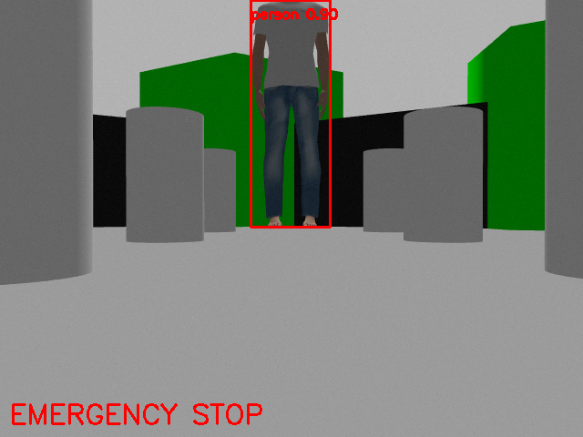
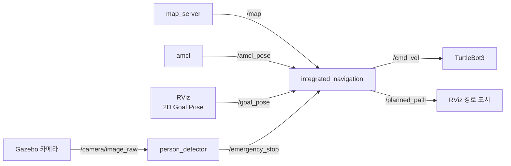

# my-car-astar

ROS 2 Humble + Gazebo 시뮬레이션에서 TurtleBot3(waffle_pi)가 **A\*로 최단 경로를 계획**하고, **Pure Pursuit으로 경로를 따라 주행**하며, 카메라로 **사람(person)이 검출되면 비상정지**하는 주행 노드입니다.

## 실행 화면



주행 중 카메라에 사람이 검출되면 빨간 박스와 `EMERGENCY STOP`이 표시되고 로봇이 정지합니다.

## 주요 기능

| 기능 | 설명 |
|---|---|
| 맵 기반 경로 계획 (A\*) | 저장된 맵(`/map`)에서 현재 위치 → 목표까지 8방향 A\* 탐색. 장애물과 안전거리(safety margin)를 유지하는 칸만 지나감 |
| 경로 추종 (Pure Pursuit) | 경로 위에서 전방 주시 거리(lookahead)만큼 떨어진 점을 따라가도록 각속도 계산 |
| 제자리 회전 | 목표가 로봇 뒤쪽(90° 초과)이면 전진하지 않고 먼저 제자리에서 회전 |
| 객체 검출 비상정지 | YOLOv8로 카메라 영상에서 `person`을 검출하면 즉시 정지, 사라지면 남은 경로를 이어서 주행 |
| 안전 종료 | Ctrl+C로 노드를 끄면 정지 명령(속도 0)을 보내고 종료 |

## 파일 구성

| 파일 | 설명 |
|---|---|
| `integrated_navigation.py` | 주행 노드: A\* 경로 계획 + Pure Pursuit 주행 + 비상정지 처리 |
| `person_detector.py` | 객체 검출 노드: YOLOv8로 사람을 검출해 비상정지 신호 발행 |

## 시스템 구성



| 노드 | 구독 | 발행 |
|---|---|---|
| `integrated_navigation` | `/map`, `/amcl_pose`, `/goal_pose`, `/emergency_stop` | `/cmd_vel`, `/planned_path` |
| `person_detector` | `/camera/image_raw` | `/emergency_stop` (`std_msgs/Bool`) |

## 개발 환경

- Ubuntu 22.04 (WSL2)
- ROS 2 Humble, Gazebo 11
- TurtleBot3 `waffle_pi` (카메라 포함 모델)
- Nav2 (`map_server`, `amcl`만 사용)
- Python: `ultralytics`(YOLOv8), `cv_bridge`, `opencv-python`, `numpy`, `torch`

## 설치

```bash
sudo apt install ros-humble-turtlebot3* ros-humble-navigation2 ros-humble-nav2-bringup ros-humble-cv-bridge
pip install ultralytics
```

`~/.bashrc`에 추가:

```bash
export TURTLEBOT3_MODEL=waffle_pi
source ~/my_ws/install/setup.bash
```

### ROS 2 패키지에 넣기

두 노드 파일을 `ament_python` 패키지(예: `my_bot`)의 모듈 폴더에 넣습니다.

```
~/my_ws/src/my_bot/
├── my_bot/
│   ├── integrated_navigation.py
│   └── person_detector.py
├── models/
│   └── yolov8n.pt
├── setup.py
└── package.xml
```

`setup.py`의 `entry_points`에 실행 명령을 등록합니다.

```python
entry_points={
    'console_scripts': [
        'integrated_navigation = my_bot.integrated_navigation:main',
        'person_detector = my_bot.person_detector:main',
    ],
},
```

```bash
cd ~/my_ws && colcon build --symlink-install
```

### 준비물

- **맵**: SLAM으로 만든 `turtlebot3_world` 맵(`.pgm`, `.yaml`)
- **YOLO 가중치**: `yolov8n.pt`를 `~/my_ws/src/my_bot/models/`에 둡니다. 다른 위치라면 `-p model_path:=<경로>`로 지정합니다.
- **사람 모델**: Gazebo Insert 탭에 `Person Standing`이 없으면 [osrf/gazebo_models](https://github.com/osrf/gazebo_models)의 `person_standing` 폴더를 `~/.gazebo/models/`에 넣습니다.

## 실행 방법

터미널 3개를 사용합니다.

```bash
# 1. 시뮬레이션 + 맵 + 위치 추정 (turtlebot3_world + nav2 map_server/amcl + RViz)
ros2 launch my_bot tb3_localization.launch.py map:=<맵 yaml 절대 경로>
```

```bash
# 2. 주행 노드
ros2 run my_bot integrated_navigation
```

```bash
# 3. 객체 검출 노드
ros2 run my_bot person_detector
```

1. RViz에서 **2D Pose Estimate**로 로봇의 초기 위치와 방향을 지정합니다.
2. RViz에서 **2D Goal Pose**로 목표를 찍으면 경로를 계산하고 주행합니다.
   - Nav2 기본 RViz 설정에는 `Nav2 Goal`만 있으므로, 도구 모음의 `+`에서 `2D Goal Pose`를 추가해야 합니다. (`Nav2 Goal`은 `/goal_pose`를 발행하지 않습니다.)
   - 계획된 경로는 RViz에서 `Add → By topic → /planned_path → Path`로 볼 수 있습니다.
3. Gazebo **Insert** 탭에서 `Person Standing`을 로봇 경로 앞에 놓으면 비상정지, 치우면 다시 출발합니다.

## 동작 원리

### 1. A\* 경로 계획
- 미터 좌표 ↔ 맵 격자(행, 열) 변환: `col = (x - origin_x) / resolution`, `row = (y - origin_y) / resolution`
- 8방향 이동, 이동 비용 `g`는 1칸당 1, 휴리스틱 `h`는 목표까지의 유클리드 거리
- `check_safety()`: 주변 `safety_margin`칸 안에 장애물이 하나라도 있으면 그 칸은 지나가지 않음 → 경로가 벽·기둥에서 떨어져 계획됨

### 2. Pure Pursuit 경로 추종
경로 위에서 `lookahead_dist` 이상 떨어진 첫 점을 목표점으로 잡고, 그 점을 지나는 원호를 따라가도록 각속도를 계산합니다.

```
angular_velocity = linear_vel × 2·sin(α) / lookahead_dist
```

- `α`: 로봇이 바라보는 방향과 목표점 방향의 차이
- 목표가 뒤쪽(|α| > 90°)이면 `sin(α)`가 다시 작아져 거의 돌지 않으므로, 이때는 전진을 멈추고 0.5 rad/s로 제자리 회전합니다.

### 3. 비상정지
- `person_detector`가 카메라 프레임마다 YOLOv8로 검출하고, `person`이 있으면 `/emergency_stop`에 `True`를 발행합니다.
- 한 프레임 놓쳐서 바로 출발하지 않도록, 마지막 검출 후 `hold_sec`(1초) 동안은 정지를 유지합니다.
- `integrated_navigation`은 `True`인 동안 속도 0을 보내고, 경로는 그대로 기억했다가 해제되면 이어서 주행합니다.

## 파라미터

**integrated_navigation** (코드 상단에서 수정)

| 이름 | 값 | 의미 |
|---|---|---|
| `lookahead_dist` | 0.35 m | 전방 주시 거리. 작을수록 경로에 붙어서, 클수록 부드럽게 주행 |
| `linear_vel` | 0.15 m/s | 전진 속도 |
| `stop_tolerance` | 0.2 m | 도착 인정 거리 |
| `safety_margin` | 6칸 (0.3 m) | 장애물과 유지할 거리. 크면 안전하지만 좁은 통로가 막힘 |

**person_detector** (`--ros-args -p 이름:=값`으로 변경)

| 이름 | 기본값 | 의미 |
|---|---|---|
| `model_path` | `~/my_ws/src/my_bot/models/yolov8n.pt` | YOLO 가중치 경로 |
| `image_topic` | `/camera/image_raw` | 카메라 토픽 |
| `target_class` | `person` | 비상정지를 걸 객체 (COCO 클래스 이름) |
| `conf` | 0.5 | 검출 신뢰도 기준 |
| `hold_sec` | 1.0 | 검출이 끊겨도 정지를 유지하는 시간 |
| `threads` | 2 | YOLO CPU 스레드 수 |
| `show` | true | 검출 화면 표시 |

예: `ros2 run my_bot person_detector --ros-args -p target_class:=chair -p conf:=0.6`

## 테스트 결과 (Gazebo, turtlebot3_world)

| 시나리오 | 결과 |
|---|---|
| 목표 (1.6, -0.55)로 주행 중 앞쪽 (1.3, -0.55)에 사람 등장 | 사람 2.1 m 앞에서 비상정지, 8초간 정지 유지 |
| 사람 제거 | 약 1.5초 뒤 재출발, 목표 8 cm 이내 도착 |
| 로봇 뒤쪽 목표 (-2.0, -0.5) | 제자리 회전 후 주행, 7 cm 이내 도착 |
| 여러 목표 연속 주행 | 장애물과 최소 0.24 m 이상 거리 유지 |

## 한계 및 개선점

- **검출 지연**: Gazebo와 RViz가 CPU를 많이 사용하는 환경(WSL2, 소프트웨어 렌더링)에서는 YOLO가 프레임당 1.5~3초 걸려, 사람이 나타난 뒤 정지까지 약 4초(0.15 m/s 기준 약 0.8 m)가 걸렸습니다. GPU 사용, Gazebo GUI 끄기, 입력 해상도 축소로 개선할 수 있습니다.
- **카메라 시야**: 카메라가 낮게(약 0.1 m) 달려 있어 사람에게 약 2 m 이내로 다가가면 다리만 보입니다.
- **동적 장애물 미반영**: A\*는 저장된 맵만 사용하므로, 맵에 없는 장애물은 경로 계획에서 피하지 못합니다(비상정지로만 대응).
- **위치 갱신 주기**: `/amcl_pose`는 로봇이 일정 거리·각도 이상 움직였을 때만 갱신되므로, 주행 중 위치 정보가 띄엄띄엄 들어옵니다.
- **목표 제한**: 장애물에서 `safety_margin`(0.3 m) 이내는 목표로 지정할 수 없습니다(`No Path Found`).
